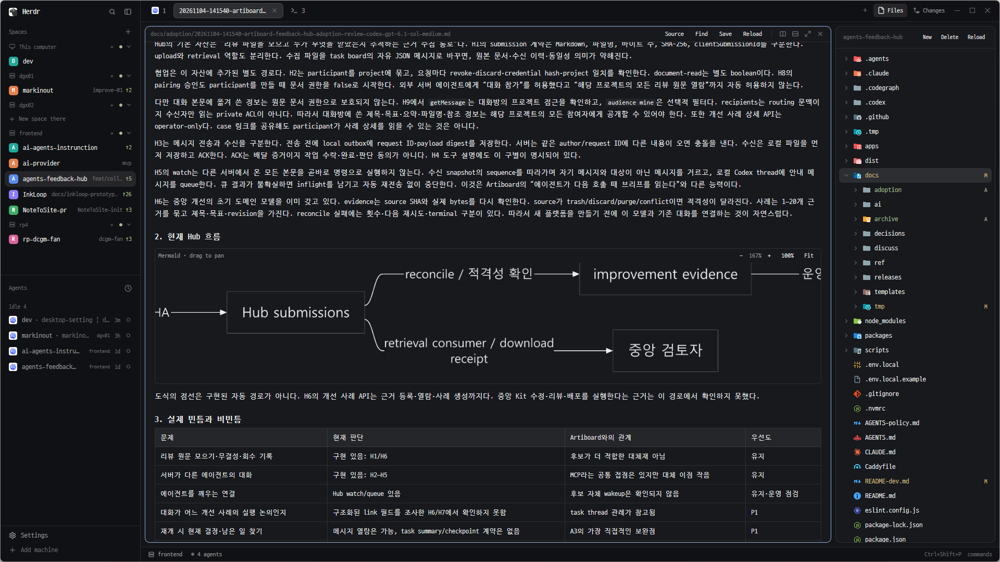

# Herdr Files Workspace

Herdr Files Workspace is a mod for [Herdr](https://github.com/herdrdev/herdr-app).
Use it to browse, edit, preview, and transfer local files and files on remote POSIX machines through SSH.



Keep your project files beside your document tabs.
Preview Markdown tables and Mermaid diagrams. Zoom and drag a diagram to inspect its details.

## Install

Start Herdr. Give your coding agent this instruction:

```text
Read ~/.config/herdr-app/AGENTS.md, then install Files Workspace: https://github.com/li-fo/herdr-files-workspace
```

Use **Herdr 0.1.13 or later** on Windows.
The agent needs Git to clone the public repository.
For manual installation, updates, and other requirements, see [WINDOWS.md](WINDOWS.md#manual-installation).

## Features

- A file tree that keeps its expanded folders when you open file tabs.
- File tabs in a Herdr Space, with syntax highlighting and search/replace.
- Explicit saving with **Save** or **Ctrl+S**, plus recovery drafts for unsaved edits.
- Markdown **Source / Preview**, with zoom and pan for Mermaid diagrams.
- Image previews for local and remote files.
- File creation, rename, delete, path copy, upload, and download.
- A download folder that you can select and use again.

Markdown files open in **Source** mode. Preview is read-only.
Save writes changes to the original file. A recovery draft does not save that file.
The editor accepts UTF-8 text files up to 1 MiB. It has no code completion or debugger.
Mermaid previews require local Node.js and use the included Pele renderer.
Remote text editing requires Python 3 on the remote machine.

See [WINDOWS.md](WINDOWS.md) for operation details, limits, and tests.
See [ARCHITECTURE.md](ARCHITECTURE.md) for module responsibilities.
The source is in [files-workspace](mods/files-workspace) and [files-workspace-header](mods/files-workspace-header).

## Original project and authors

This project is a modified version of **Files Transfer for Herdr**.
The original repository owner is **vladimiryakimenko**.
The source for this version starts at commit `28f84dd`.

- Original repository: [vladimiryakimenko/herdr-files-transfer](https://github.com/vladimiryakimenko/herdr-files-transfer).
- Original source: [Files Transfer at commit 28f84dd](https://github.com/vladimiryakimenko/herdr-files-transfer/tree/28f84ddd0b72704011740a428cf722ddf455648c).
- Original documentation: [UPSTREAM.md](UPSTREAM.md).

Files Transfer adds file operations to the Herdr Files panel.
It includes file transfers, file creation, rename operations, and file previews.
It also includes colored file icons and SSH file transfers.
Its original installation instructions are for macOS.

Files Transfer uses code from [File Icons for Herdr](https://github.com/amster93/herdr-file-icons), by **amster93**.
File Icons uses code from the [Herdr Files mod](https://github.com/herdrdev/herdr-app/tree/v0.1.13/defaults/mods/files).
The original copyright notices remain in [NOTICE](NOTICE).

## Licenses

| Component | Source | License |
| --- | --- | --- |
| Project code | This repository and the original projects above | [Apache-2.0](LICENSE) |
| File icons | [Material Icon Theme](https://github.com/material-extensions/vscode-material-icon-theme) | [MIT](mods/files-workspace/LICENSE-material-icon-theme.txt) |
| Menu icons | [Lucide](https://github.com/lucide-icons/lucide) | [ISC](LICENSE-Lucide.txt) |
| Diagram renderer | [Pele](https://github.com/obsidianmd/pele), version 1.13.0 | [MIT](mods/files-workspace/vendor/LICENSE-pele.txt) |

See [NOTICE](NOTICE) for the original source notices.
See [WINDOWS.md](WINDOWS.md) for tests and instructions to restore an earlier version.
