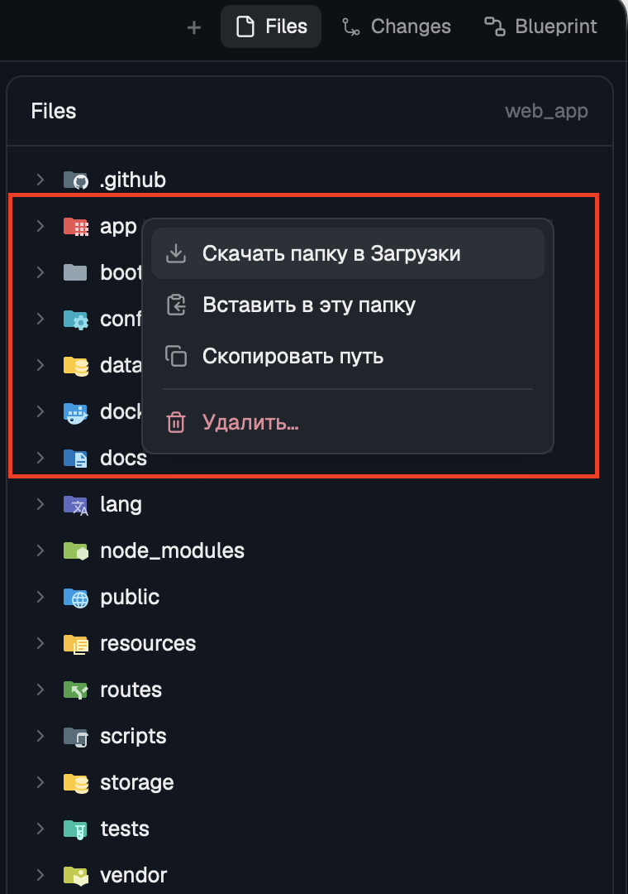

# Herdr Files Workspace

Current behavior and installation are documented in [README.md](README.md) and [WINDOWS.md](WINDOWS.md). The design notes below describe the inherited upstream interface; file opening now uses editable Space tabs.

Herdr's Files panel with file transfer and VS Code's file icons. Right-click a file or folder for a small menu: download it to `~/Downloads`, paste files copied in Finder into it (upload), copy its path, reveal it in Finder, create a file or folder, rename it, move it to the Trash (this Mac) or delete it after a confirmation (remote). Markdown opens formatted and images open fitted; paired with Preview Plus, Markdown, images and PDFs open there. It works on this computer and on remote machines the space runs on (over ssh). Files dragged from Finder onto the panel upload too. It replaces the shipped Files panel in the person's layout.

## What you see

- **The panel**, wherever the layout's Files block is (in Herdr's `main`: the right-hand panel opened with the tab bar's Files button). `background` fill, 1px `border`, 10px radius.
- **Header**, 42px, 1px `border` under it: "Files" semibold; on the right, 12px `dim`, the shown folder's name. With a file open: a `←` on the left and, on the right, the file's 14px icon and its path.
- **Tree**, 6px padding; rows 28px, 7px radius, the selected row (last clicked or right-clicked) on `selected`, `hover` background on hover, 13px text: 8px + 18px per depth; a 12px chevron (`dim`) for folders, an empty 12px slot for files; the item's **16px full-colour icon** (Material Icon Theme, drawn with `image()`); the name, truncated; the git mark on the right, 11px (`A` in `ansi2`, `M` in `blocked`, `D`/`U` in `ansi1`). Folders first, then files, each alphabetical; `.git` and the mod's own `.herdr-upload.*` / `.herdr-download.*` folders are never listed.
- **Transfer line**, only while something transfers: 30px at the bottom, 1px `border` on top, 12px `muted`: a 12px spinner (`working`, one turn per 900 ms) and "Downloading a.txt…", "Uploading folder…" or "Transferring 3…".
- **Menu** (popup at the pointer, 250px wide, `popover`, 5px padding, 12.8px text): 31px rows, 7px radius, `hover` on the row under the pointer or picked with ↑/↓; a 14px glyph in `muted` and the label in `foreground`. Delete is in `ansi1` (glyph and text) below a 1px `border` divider (4px vertical margin, 7px side margin). Items:
  - file: Download to Downloads, Paste here, Copy path, Reveal in Finder (local only), divider, Delete…
  - folder: Download folder to Downloads, Paste into this folder, Copy path, Reveal in Finder (local only), divider, Delete…
  - empty space in the tree: Paste here, Copy path (for the shown folder).
- **Delete confirmation** (dialog, 420×176, `popover`, 18px padding, 10px gap): "Delete file “a.txt”?" (14px semibold), the path (`machine:path` for a remote one, 12px `muted`), "This can't be undone." or, for a folder, "The folder and everything in it will be deleted. This can't be undone." (12px `dim`); at the bottom right Cancel (`input` border) and Delete (`ansi1` fill, `background` text), 32px high, 8px radius.
- Text is Russian when macOS's first preferred language is Russian, else English.

## How it behaves

| Action | Result |
| --- | --- |
| Click a folder / file | Opens or closes it / shows it read-only in the panel (as the shipped Files panel) |
| Right-click a row or the tree's empty space | The menu for that item / for the shown folder; Esc or a click outside closes it; Enter picks |
| Download | Copies to `~/Downloads` under a free name (`a (1).txt`, `folder (1)`); remote: `scp -r -p` from the machine's ssh address; local: `cp -R -p`. Toast "Downloaded a.txt" with the path, or the scp error |
| Paste | Reads the file paths Finder put on the clipboard; uploads them into the folder (a file's: its parent; the empty space: the shown folder). "Nothing to paste" toast when the clipboard holds no files |
| Click a row, then ⌘V | Paste into the selected folder, beside the selected file; with nothing selected (a press on empty tree space clears it, so does Esc) into the shown folder |
| Drop files from Finder | On a folder: into it; on a file: beside it; on empty space: into the shown folder |
| Upload finishes | Items move into place under free names (never overwriting); toast "Uploaded a.txt" or "Uploaded 3 items"; the tree refreshes |
| Delete… → Delete (or Enter) | `rm -rf` on the item's machine; toast "Deleted a.txt"; the tree refreshes; an open preview of it closes. Cancel or Esc does nothing |
| New file… / New folder… / Rename… | A 440×214 dialog: title, "In <folder>", a Name input (rename preselects the name without its extension), Cancel and Create/Rename; Enter submits, Esc cancels. Names with `/` or control characters, `.` and `..` are refused in the dialog; an existing name gives a toast "“x” already exists" (the scripts exit 17 instead of replacing). The new entry's folders open and it is selected |
| Move to Trash (local) | `trash <path>` (macOS `/usr/bin/trash`, Put Back works); no confirmation |
| Click Markdown / an image | Formatted Markdown with a Source/Preview chip in the header / the image fitted to the panel, with size info and Open in Preview. Remote images are copied here first; HEIC, TIFF, AVIF and ICO are converted with `sips` |
| Copy path / Reveal in Finder | The absolute path (on its machine) to the clipboard / Finder selects the local item |

The panel follows the focused pane's folder (on its machine), refreshes every 10 s and on local folder changes, exactly like the shipped Files panel. No agent statuses are shown.

## Built from

- **One mod**, `mods/files-workspace/`, `mod.json` `{ "place": "none" }`. `main.js` is Herdr's shipped `files` mod with File Icons' changes (`DIR`, `icon(path, dir, open, dark)` from `icons.js`, `image()` icons) plus the menu and transfers. `icons/` (1184 SVGs) and `icons.js` come from Material Icon Theme 5.40.0 via `tools/build-icons.mjs`. Glyphs: `download.svg`, `paste.svg`, `copy.svg`, `trash.svg`, `chevron-*.svg` (Lucide), `finder.svg`, `spinner.svg` (Herdr's workspace-chrome).
- **The same mod draws three things**: the panel; the menu when `props().menu` is set (`openOverlay({ mod: "files-workspace", kind: "popup", width: 250, props: { menu: target } })`); the confirmation when `props().confirm` is set (`kind: "dialog"`). The overlays hand the choice back through shared `files-workspace.request` (`{ id, action, path, name, dir, on, from }`), and only the panel copy whose random `from` id opened the menu acts on it. That's because an overlay's tasks end when it closes, and a transfer outlives it.
- **Layout**: the Files block keeps `"id": "files"` (the tab bar's button selects it by id) and gets `"content": { "mod": "files-workspace" }`. `install.sh` clones a shipped layout first.
- `herdr`: `spaces`, `panes`, `focused`, `exec` (with `on` for the space's machine), `hc(["machine","ls","--json"])` (a machine's ssh `target`), `readTextFile`, `watchFolder`, `theme`, `settings`, `window`, `props`, `openOverlay`, `closeOverlay`, `shared`/`setShared` (`files-workspace.request`, `files-workspace.lang`), `notify`, `appHome`, `home`.
- **Programs**: `scp`, `cp`, `mktemp`, `mv`, `ln`, `rm`, `sh`, `git`; macOS `osascript -l JavaScript` (NSPasteboard file URLs), `pbcopy`, `open -R`, `defaults read -g AppleLanguages`.
- **Transfers run detached** (`nohup sh -c … &`) because `exec` stops at 30 s. Each writes its exit code to `<app home>/data/files-workspace/<id>` (and `.log`, `.dest`); the panel polls those once a second while any transfer runs. Download: into `mktemp -d ~/Downloads/.herdr-download.XXXXXX`, then claim a free name. Upload: `mktemp -d <dir>/.herdr-upload.XXXXXX` on the target, scp/cp into it, then a script on the target moves each item into place under a free name and prints the names it used.

- **Pairing with Preview Plus** (optional): the layout's `files` block becomes a stack whose children are `files-plus-tree` (this mod, `props.previewStack: "files"`) and `preview-plus`. A click on `.md`, `.png`, `.jpg`, `.webp`, `.svg` or `.pdf` writes `shared("preview-plus.target")[spaceId] = { file, root, on }` and runs `layout.select { stack, child: "preview-plus" }`; Preview Plus's Back selects `files-plus-tree` (that id is fixed by Preview Plus). Remote media are staged here first and handed over with `on: null`.

## Watch out

- **Free names must be claimed atomically.** Checking `[ -e ]` and then moving lets two transfers that finish together overwrite each other. Claim files with `ln tmp/x dest` (fails if dest exists) and folders with `mkdir dest`, then move the folder's contents in (globs `* .[!.]* ..?*` so dotfiles come too).
- **scp's remote path isn't shell-quoted.** OpenSSH 9+ uses SFTP, so `host:/path with spaces` works as is. Don't add quotes.
- **`exec` with `on` takes an argument array.** Run remote steps (mktemp, place, rm) through it, not through `ssh host "cmd"`, which needs quoting.
- **ssh needs no prompts:** `-o BatchMode=yes -o ConnectTimeout=15`, or a transfer hangs forever.
- **A popup's `cx` tasks die with it**, so never run the action in the menu copy.
- ⌘V needs the keyboard: the panel's root has `track_focus(handle)` and `on_key_down` comparing `event.keystroke === "cmd-v"`, and a row click calls `handle.focus()`. A layout block doesn't get the keyboard by itself.
- `on_size_change` reports window points: divide by `settings().zoom` before fitting an image.
- The name `LANG` is already used (the preview's language map); the language key is `LANG_KEY`.
- Refuse to delete the shown folder itself or a path with fewer than two parts (`/etc`, `/home`).
- Paste, Copy path, Reveal in Finder and the language check are macOS only. Windows and Linux are not supported.
- Large deletes go through `exec` and can hit its 30 s limit.

## Done when

- `herdr-app check mods/files-workspace` passes, and the Files button shows the tree with coloured icons.
- In a remote space, Download on a file puts it in `~/Downloads`; doing it twice gives `name (1).ext`; Download on a folder brings its dotfiles too.
- Copy a file and a folder in Finder, then Paste into this folder on a remote folder: both appear there; pasting again gives `name (1)` copies; no `.herdr-upload.*` folder is left.
- Dropping a file from Finder onto a folder uploads it into that folder.
- Clicking a remote folder and pressing ⌘V with a file copied in Finder uploads it there; with no files on the clipboard a "Nothing to paste" toast shows.
- Delete… opens the confirmation with the machine and path; Esc leaves the file; Delete removes it and the row disappears.
- With macOS in Russian the menu reads «Скачать в Загрузки»; otherwise "Download to Downloads".
