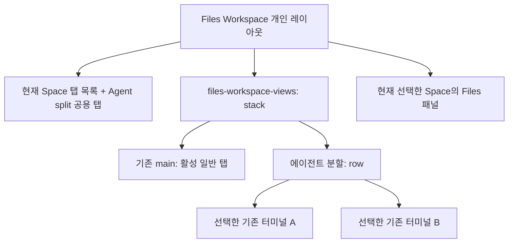
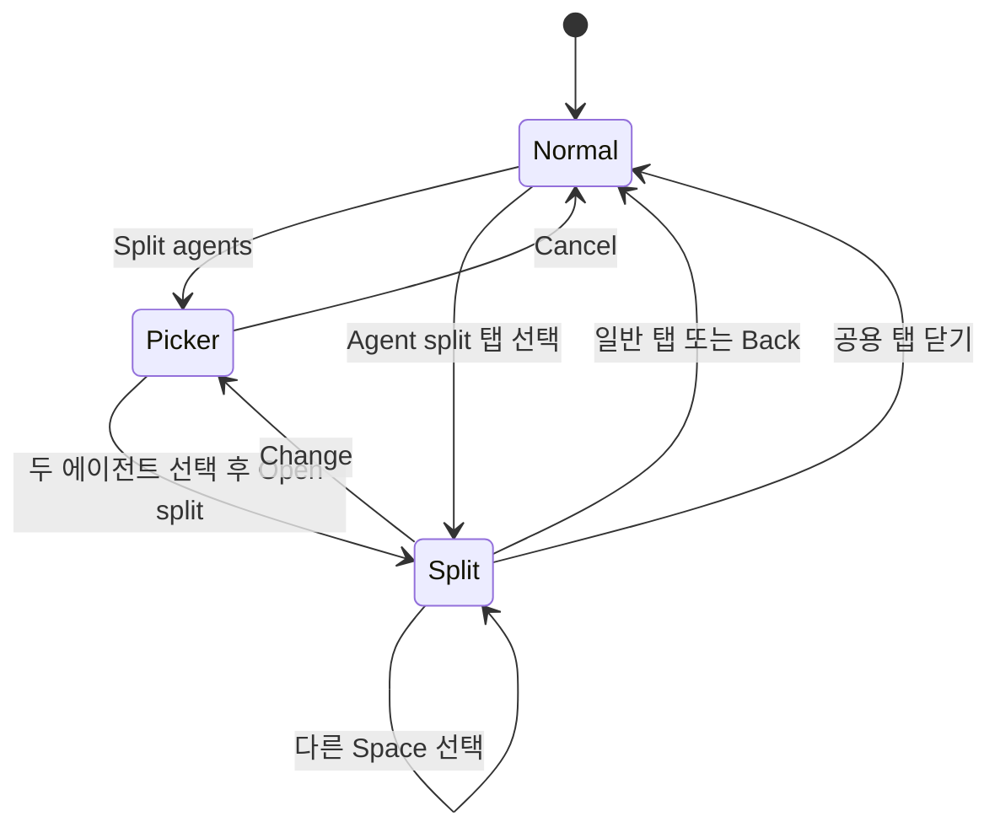
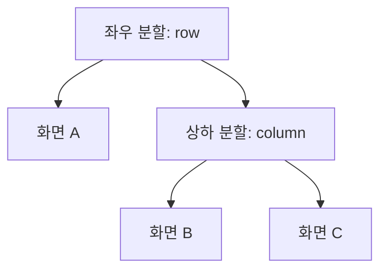
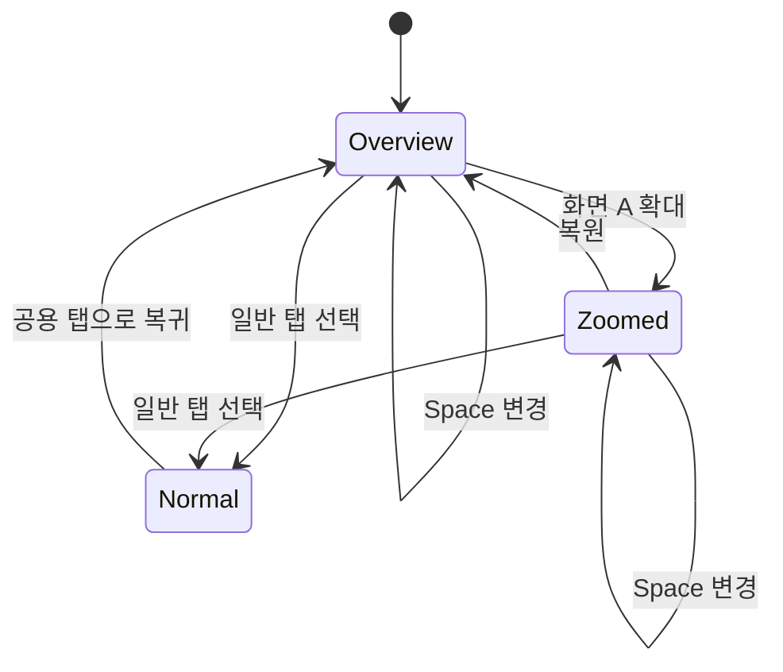
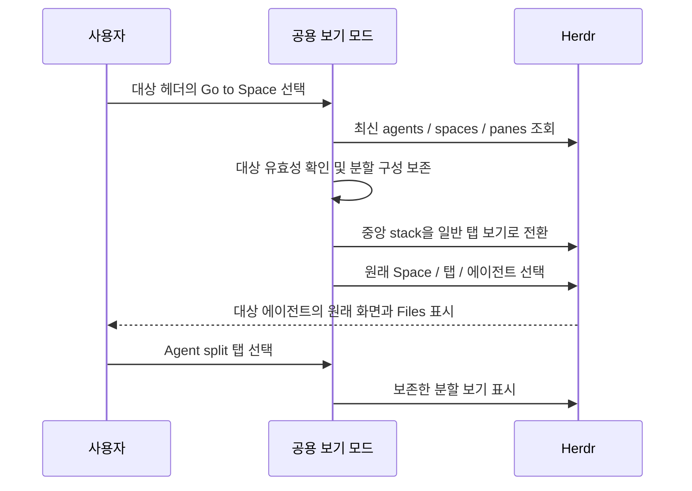
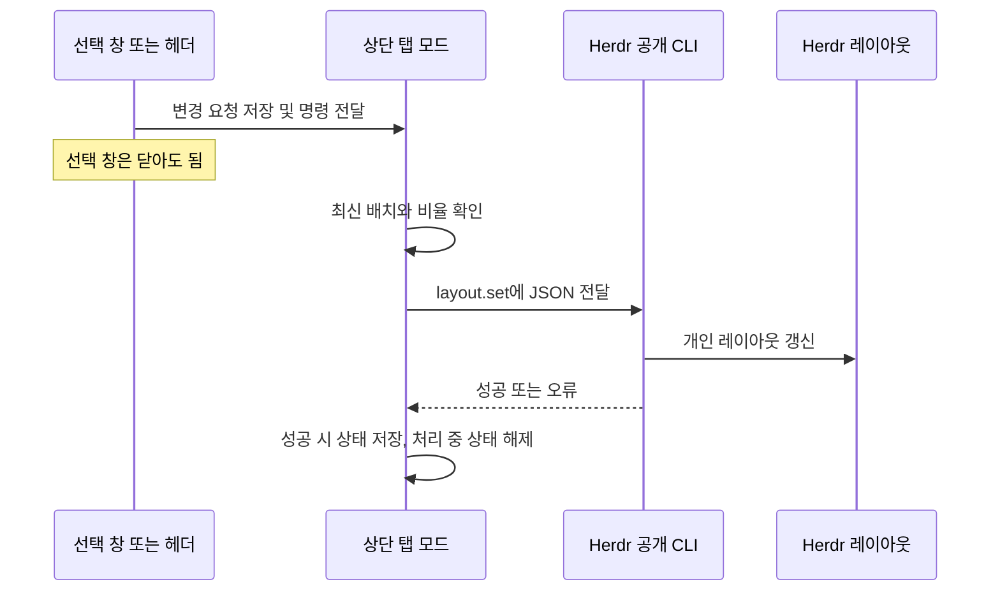

# Agents View: Space 공용 에이전트 보기

현재 확장 구현은 **16~18절**에 기록한다. 1~8절은 최초 두 화면 구현 기록이며, 9~15절은 당시 후속 검토 기록이다. UI 이름은 확장 구현에서 **Agents View**로 변경했다.

## 1. 목적

서로 다른 Space에서 실행 중인 에이전트 두 개를 같은 화면에 표시한다. Space를 전환해도 분할 화면을 유지한다. Files 패널은 현재 선택한 Space의 파일을 표시한다.

- 구현일: 2026-11-11 (Asia/Seoul)
- 검증 환경: Windows, Herdr 0.1.15
- 구현 위치: Files Workspace 모드와 개인 레이아웃
- Herdr 본체 수정: 없음
- 커밋 및 푸시: 수행하지 않음

## 2. 사용자 동작

1. 상단의 **Split agents**를 선택한다.
2. 에이전트 두 개를 선택한다. 선택 순서의 `1`과 `2`는 왼쪽과 오른쪽 위치를 뜻한다.
3. **Open split**을 선택한다.
4. 상단의 **Agent split** 공용 탭에서 두 터미널을 확인한다.
5. 터미널을 클릭하여 입력 대상을 선택한다. 중앙 경계를 드래그하여 너비를 조정한다.

| 조작 | 결과 |
| --- | --- |
| 다른 Space 선택 | 해당 Space의 탭 목록과 Files 패널로 전환한다. 선택 중인 분할 화면은 유지한다. |
| 일반 탭 선택 | 분할 화면을 숨기고 일반 탭을 표시한다. |
| Agent split 선택 | 기존 두 에이전트를 다시 표시한다. 동일한 조합이면 분할 레이아웃을 다시 만들지 않는다. |
| Change 선택 | 에이전트 선택 창을 연다. 기존 선택을 해제하고 새 대상을 선택할 수 있다. |
| Back 선택 | 현재 Space의 일반 탭 화면으로 돌아간다. |
| 공용 탭의 × 선택 | 분할 보기와 저장된 선택을 제거한다. 원래 에이전트와 탭은 종료하지 않는다. |
| 에이전트가 사라짐 | 헤더에 상태를 표시한다. Change에서 다른 에이전트를 선택할 수 있다. |

닫기 동작은 `terminal.kill`, `pane.close`, `tab.close`를 호출하지 않는다. 실행 중인 에이전트에게 새 메시지나 키를 전송하지 않는다.

## 3. 화면 구조

Herdr의 기본 탭은 Space에 속한다. 이 기능은 기본 탭을 다른 Space로 이동시키지 않는다. 사용자 정의 탭 줄에서 공용 탭을 표시하고 중앙 레이아웃의 선택을 바꾼다.



`stack`은 일반 작업 화면과 분할 화면 중 하나만 표시한다. Files 패널은 이 `stack` 밖에 있다. 두 터미널은 Herdr의 네이티브 터미널 블록으로 렌더링한다.



선택 창을 취소하면 열기 직전 화면을 유지한다. 위 다이어그램의 `Normal` 복귀는 일반 화면에서 선택 창을 연 경우를 표시한다.

## 4. 구현 파일

| 파일 | 역할 |
| --- | --- |
| `mods/files-workspace-agents/main.js` | 선택 창, 터미널 헤더, 모드 명령 처리 |
| `mods/files-workspace-agents/tabs.js` | 기존 탭 UI와 공용 탭 표시, Space 전환과 포커스 처리 |
| `mods/files-workspace-agents/split.js` | 레이아웃 검색·생성·제거와 상태 판단을 위한 순수 함수 |
| `mods/files-workspace-agents/actions.js` | 공개 API를 통한 레이아웃 선택·갱신과 선택 창 열기 |
| `mods/files-workspace/main.js` | 분할 터미널의 경로가 Files 패널을 다른 Space로 이동시키지 않도록 처리 |
| `install-windows.ps1` | 세 모드 설치, 기존 일반 화면을 stack으로 감싸기, 백업·복구 |
| `tests/macos/install-herdr-workspace-macos.py` | 동일한 모드와 레이아웃 연결을 위한 설치 코드 갱신 |

`tabs.js`는 Herdr 0.1.15의 기본 탭 모드에서 파생했다. 출처와 Apache-2.0 라이선스는 새 모드의 `NOTICE` 및 `LICENSE`에 기록했다. Herdr의 기본 모드 파일은 수정하지 않았다.

## 5. 상태와 포커스

선택한 두 터미널의 주소·표시 이름·머신을 `files-workspace.agent-split` 공유 상태에 저장한다. 터미널 블록은 개인 레이아웃에도 저장한다. Space별 탭을 복제하거나 에이전트를 새로 실행하지 않는다.

일반 탭의 선택 변경은 일반 화면으로 돌아가는 신호로 사용한다. Space만 변경되면 분할 보기를 유지한다. 같은 일반 탭을 다시 클릭해도 일반 화면으로 돌아간다.

Space 전환은 본체에서 해당 Space의 원래 탭으로 포커스를 바꿀 수 있다. 분할 화면이 표시 중이면 마지막으로 표시한 분할 터미널 또는 첫 번째 터미널로 포커스를 돌린다. 숨겨진 원래 터미널로 입력이 향하지 않도록 하기 위한 처리다.

Files 패널은 레이아웃 터미널에 포커스가 있을 때 그 터미널의 `cwd`와 머신을 사용하지 않는다. 선택된 Space의 활성 탭과 원래 Pane을 기준으로 경로를 결정한다. 기존 파일 탭의 탐색 경로 유지 동작도 보존한다.

## 6. 리소스 및 호환성

- 에이전트 목록은 Herdr의 실시간 데이터를 사용한다. 별도 폴링이나 백그라운드 프로세스는 추가하지 않았다.
- 공용 분할 보기는 한 개이며 터미널은 두 개로 제한한다.
- 터미널 렌더링 비용은 두 화면을 동시에 표시하는 만큼 추가된다.
- 새 일반 `ScrollHandle`이 있으면 활성 공용 탭이 보이도록 사용한다. 없으면 해당 자동 스크롤을 생략한다.
- 최소 버전 표기는 0.1.13을 유지한다. 이번 기능의 실제 앱 검증은 0.1.15에서 수행했다. 0.1.13 및 0.1.14에서의 전체 동작은 이번에 검증하지 않았다.
- 기본 형태의 `tabs` 및 `main` 블록이 없는 사용자 정의 레이아웃에는 설치기가 자동으로 공용 탭을 연결하지 않는다.
- 일반 Pane의 분할·닫기 컨트롤을 터미널 블록에 재사용하지 않는다.
- 재시작이나 원격 세션 재생성으로 기존 주소가 사라지면 Change에서 다시 선택한다. 앱 재시작 및 원격 연결 장애의 전체 복구 과정은 이번 검증 범위에 포함하지 않았다.

## 7. 검증 결과

| 검증 | 결과 |
| --- | --- |
| `node tests/agent-split.mjs` | 레이아웃 보존, 중복 방지, 안전한 닫기, 선택 창 이벤트, Space 전환, 포커스 복구, 일반 탭 복귀 통과 |
| `node tests/sidebar-location.mjs` | 다른 Space의 터미널 포커스와 Files 경로 분리, 기존 탐색 경로 유지 통과 |
| `node tests/file-tabs.mjs` | 파일 탭 관련 회귀 검사 통과 |
| `node tests/tab-history.mjs` | 탭 방문 기록 회귀 검사 통과 |
| `node tests/editor-header.mjs` | 편집기 헤더 및 관련 동작 회귀 검사 통과 |
| `tests/installer.ps1` | 설치 실패 복구, 관리 파일 보존·정리, stack 연결, 재설치 시 중복 방지 통과 |
| 세 모드의 `herdr-app check` | 저장소 원본 및 설치된 모드 검사 통과 |
| 실제 선택 창 | 실행 중인 에이전트 목록과 선택 컨트롤 표시 확인 |
| 실제 분할 화면 | `frontend/t2`와 `frontend/t3`의 동시 렌더링 확인 |
| 실제 Space 전환 | 로컬 `dev`로 전환해도 두 원격 화면 유지, Files 패널은 로컬 `dev` 표시 확인 |
| 실제 포커스 | 분할 터미널 포커스 명령 및 Space 전환 후 `fw-agent-terminal-0` 유지 확인 |
| 앱 오류 | 검증 후 `herdr-app status`의 오류 목록이 비어 있음 |
| CodeGraph | 변경 후 인덱스 동기화 완료 |

선택 창 클릭 흐름은 모의 UI 테스트로 검증했다. 실제 앱에서는 선택 창과 분할 레이아웃을 별도로 표시하여 확인했다. 에이전트에 실제 텍스트를 입력하지 않았으며, 마우스로 경계를 드래그하는 조작과 macOS 동작은 이번에 검증하지 않았다.

실제 앱 검증은 기존 세션을 종료하지 않고 수행했다. 검증 후 원래 Space와 일반 탭 화면으로 복구했다. 상단의 Split agents에서 사용자가 원하는 조합을 선택할 수 있다.

## 8. 설치 및 후속 확인

현재 Windows 앱에 설치를 완료했다. 마지막 설치 백업은 다음 경로에 있다.

```text
C:\Users\pgh\.config\herdr-app\backups\files-workspace-c3a23c60d1df4c5ebea51474f4a7beb9
```

사용자는 다음을 확인한다.

1. Split agents에서 두 대상을 선택한다.
2. 두 터미널을 번갈아 클릭하고 입력 대상이 맞는지 확인한다.
3. 다른 Space를 선택하고 파일 패널의 경로를 확인한다.
4. 일반 탭과 Agent split 사이를 전환한다.
5. 분할 탭을 닫고 원래 에이전트가 계속 실행 중인지 확인한다.

기존 미커밋 변경은 보존했다. 사용자 테스트 후 요청에 따라 커밋 또는 푸시한다.

## 9. 후속 확장 검토의 범위

사용자는 기존 Split agents의 동작을 확인했다. 이후 다음 기능을 요청하여 구현 가능성과 설계 방향을 검토했다.

1. 표시 중인 에이전트의 위치를 교환한다.
2. 여러 에이전트를 좌우·상하 또는 혼합 배치로 표시한다.
3. 하나의 에이전트를 확대하고 원래 배치로 복원한다.
4. 표시 중인 에이전트의 원래 Space와 탭으로 이동한다.

**9절 이후는 설계 검토이며 구현 완료 기록이 아니다.** 앞의 1~8절은 현재 두 에이전트 분할 기능을 설명한다. 이번 후속 작업은 문서만 갱신하며 모드나 설치된 앱을 변경하지 않는다.

| 기능 | 검토 결과 | 현재 상태 |
| --- | --- | --- |
| 위치 교환 | 공개 레이아웃 API로 구현 가능 | 전용 교환 버튼 없음. 선택 순서를 바꾸어 재구성 가능 |
| 여러 에이전트 | 모드의 두 개 제한을 제거하고 상태 구조를 확장하여 구현 가능 | 두 개로 제한 |
| 혼합 분할 | `row`와 `column` 중첩으로 구현 가능 | 좌우 배치만 생성 |
| 확대·복원 | 전체 배치를 보존하고 표시 영역을 전환하여 구현 가능 | 미구현 |
| 원래 Space로 이동 | 일반 화면 전환과 에이전트 탐색 명령을 조합하여 구현 가능 | 헤더의 Back은 현재 Space로 돌아갈 뿐 대상 Space로 이동하지 않음 |

본체의 내부 Rust 메서드가 있다는 이유로 모드에서 호출할 수 있다고 판단하지 않는다. 이 설계는 공개 `layout.set`, `layout.select`, `space.select`, `tab.select`, `pane.focus`, `agent.focus`의 범위 안에서 구성한다.

## 10. 위치 변경

### 10.1 현재 가능한 방법

현재는 Change를 열고 두 항목을 모두 선택 해제한 뒤 반대 순서로 선택하면 좌우를 바꿀 수 있다. 예를 들어 `dev → agents-feedback` 순서를 `agents-feedback → dev`로 바꾼다.

이 방법은 분할 구성을 다시 생성하므로 조정한 너비 비율이 초기화된다. 전용 위치 교환 기능과는 구분한다.

### 10.2 권장 동작

두 화면에서는 **위치 교환**을 제공한다. 여러 화면에서는 **다른 화면과 교환**을 제공하고 교환 대상을 선택하게 한다.

교환 시 다음 원칙을 적용한다.

- 터미널 세션을 새로 실행하지 않는다.
- 원래 Space와 탭의 소속을 변경하지 않는다.
- 영역의 크기 비율은 위치에 남긴다. 에이전트 화면만 서로 바꾼다.
- 입력 포커스는 가능하면 기존 에이전트를 따라간다.
- 같은 화면을 대상으로 선택하면 변경하지 않는다.

초기에는 메뉴 방식으로 구현하는 것이 적절하다. 헤더 드래그를 통한 이동은 별도 단계로 검토한다. Herdr 기본 Pane의 드래그 이동은 레이아웃 터미널 블록에 적용되지 않는다. 모드에서 시작 영역, 대상 강조, 드롭 위치, 취소, 순서 변경을 직접 관리해야 한다.

## 11. 여러 에이전트와 혼합 분할

### 11.1 사용자 조작

각 화면의 메뉴에 **오른쪽에 추가**, **아래에 추가**, **이 화면 제거**를 제공하는 구성이 적절하다. 오른쪽 추가는 좌우 배치를 만들고, 아래 추가는 상하 배치를 만든다. 세로 분할과 가로 분할이라는 표현만 사용하는 것보다 결과를 명확하게 알 수 있다.

```text
좌우 배치             상하 배치             혼합 배치
┌─────┬─────┐        ┌───────────┐        ┌─────┬─────┐
│  A  │  B  │        │     A     │        │     │  B  │
│     │     │        ├───────────┤        │  A  ├─────┤
│     │     │        │     B     │        │     │  C  │
└─────┴─────┘        └───────────┘        └─────┴─────┘
```

처음부터 자유로운 격자 편집기를 만들 필요는 없다. 화면 하나를 선택하여 옆이나 아래에 추가하는 동작을 반복하면 혼합 배치를 만들 수 있다.

### 11.2 배치 데이터

현재는 선택 목록 두 개를 단일 `row`로 변환한다. 확장 시에는 선택 목록과 배치 정보를 구분해야 한다.

| 정보 | 용도 |
| --- | --- |
| 화면의 고유 ID | 위치가 바뀌어도 같은 화면을 식별 |
| 터미널 주소 | 기존 세션에 연결 |
| Space 및 탭 식별자 | 원래 작업 화면으로 이동할 때 사용. 실행 시 최신 데이터로 재확인 |
| 분할 노드 ID와 방향 | 좌우 및 상하 관계를 표현 |
| 자식 노드와 비율 | 화면 배치와 크기를 복원 |
| 포커스 대상 ID | 배치 변경 후 입력 대상을 복원 |
| 확대 대상 ID | 전체 배치와 확대 표시 상태를 구분 |
| 상태 형식 버전 | 기존 두 개 선택 상태를 새 구조로 변환 |

다음은 A를 왼쪽에 두고 B와 C를 오른쪽 위아래에 두는 개념 구조이다.



현재 `fw-agent-0`, `fw-agent-1`처럼 배열 위치에 종속된 ID는 안정적인 화면 ID로 전환하는 것이 좋다. 주소를 ID로 그대로 사용하기보다 별도 ID를 부여하면 대상을 교체할 때도 영역을 유지하기 쉽다.

ID를 유지하면 불필요한 뷰 재생성을 줄일 수 있다. 다만 `layout.set` 호출 후 네이티브 터미널의 스크롤·포커스가 보존되는지는 실제 앱에서 검증해야 한다. ID 유지 자체가 모든 내부 상태의 보존을 보장하지는 않는다.

### 11.3 화면 제거와 예외

- 화면 제거는 표시 연결만 해제한다. 세션을 종료하지 않는다.
- 분할 노드에 자식이 하나 남으면 해당 노드를 정리한다.
- 하나의 에이전트만 남아도 화면을 유지한다.
- 마지막 화면을 제거하면 일반 탭으로 돌아가고 공용 보기를 닫는다.
- 초기에는 동일한 터미널의 중복 추가를 막는 것이 좋다.
- 연결이 끊긴 화면은 자동 삭제하지 않는다. 상태와 교체·제거 선택을 제공한다.
- 최소 영역 크기를 정하고 너무 작은 창에서 추가할 때의 처리를 결정한다.

## 12. 한 에이전트 확대 및 복원

### 12.1 의미와 UI

확대는 글꼴 크기를 바꾸는 기능이 아니다. 선택한 에이전트에 중앙 작업 영역 전체를 할당한다. 좌측 Space 목록과 우측 Files 패널은 유지한다.

각 화면 헤더에 **확대**를 제공하고, 확대 중에는 **복원**으로 바꾼다. 복원은 화면 제거 또는 터미널 종료와 구분한다. 사용자가 말한 확대 화면의 닫기는 이 복원 동작으로 제공하는 것이 적절하다.



위 도식은 일반 탭에서 돌아올 때 전체 보기를 표시하는 기본안을 나타낸다. 확대 상태까지 유지할지는 구현 전에 정할 세부 동작이다. Space만 전환할 때는 기존 확대 대상을 유지하는 것을 권장한다.

### 12.2 상태 보존

전체 배치를 기준 상태로 유지하고 확대 대상 ID를 별도로 저장한다. 확대를 위해 기준 배치 자체를 단일 화면으로 덮어쓰지 않는다.

복원 시 다음 항목을 유지해야 한다.

- 화면의 상대적 위치와 분할 방향.
- 사용자가 조정한 분할 비율.
- 연결된 터미널 주소.
- 가능한 범위의 터미널 스크롤과 포커스 상태.

공개 레이아웃의 표시 선택 또는 구조 변경으로 구현할 수 있다. 단, 같은 터미널을 확대용 블록과 원래 블록에 동시에 표시하는 방식은 피한다. 크기 변경과 포커스 처리에 영향을 줄 수 있으므로 표시 전환 방식은 실제 앱에서 비교 검증한다.

확대 중인 에이전트가 사라지면 상태를 표시하고 복원할 수 있게 한다. 확대 중 배치 추가·교환·제거는 우선 전체 보기로 복원한 뒤 수행하는 방식이 단순하다.

## 13. 에이전트의 원래 Space로 이동

### 13.1 요청 예시와 판단

사용자가 `dev` Space에서 공용 분할 보기를 열고 `agents-feedback`과 `ai-provider`를 표시했다고 가정한다. `agents-feedback` 헤더의 이동 버튼을 선택하면 해당 에이전트가 속한 Space와 일반 탭으로 바로 이동한다.

이 동작은 본체 수정 없이 구현할 수 있다. 공개 `agents()` 데이터에서 현재 Space·탭·Pane 관계를 확인할 수 있고, 탐색 명령도 제공된다.

| 사용자 조작 | 권장 결과 |
| --- | --- |
| 터미널 본문 클릭 | 해당 터미널에 입력 포커스만 부여. Space는 유지 |
| 헤더의 **Go to Space** 선택 | 대상 Space의 원래 에이전트 탭을 표시 |
| 이동 후 Files 확인 | 대상 Space의 파일 트리 표시 |
| 이동 후 Agent split 선택 | 기존 공용 분할 구성으로 복귀 |

본문 클릭과 Space 이동을 분리해야 분할 모니터링 중 실수로 화면이 전환되지 않는다. 처음에는 명시적인 **Go to Space** 버튼 또는 메뉴 항목을 권장한다. 헤더의 Space 이름에 같은 동작을 연결하는 것은 후속 선택 사항이다.

### 13.2 전환 순서



먼저 분할 화면을 숨기고 일반 탭 보기를 선택해야 한다. `space.select`만 실행하면 기존의 “Space를 바꿔도 분할 화면 유지” 동작에 따라 분할 화면이 계속 보인다.

일반 Pane이 있는 에이전트는 `agent.focus {terminal}`을 사용하거나, 최신 정보의 `space.select`·`tab.select`·명시적인 `pane.focus {pane}`를 조합할 수 있다. 구현 시 렌더링과 명령 반영 순서를 확인한다.

`pane.focus {terminal}`만 호출하는 방법은 원래 Space로 이동하기 위한 수단으로 사용하지 않는다. 같은 주소의 레이아웃 터미널이 보이면 해당 블록을 우선할 수 있기 때문이다.

분할 보기를 닫는 `closeSplit()`을 사용해서도 안 된다. 이 동작은 저장된 선택을 제거한다. 이동은 구성을 보존한 채 일반 화면만 선택하는 별도 동작이어야 한다.

### 13.3 데이터와 예외 처리

현재 선택 상태는 주소·표시 이름·머신을 저장한다. 원래 Space로 이동할 때 표시 이름으로 대상을 찾지 않는다. 동일한 이름이 있거나 이름이 변경될 수 있다. 클릭 시 최신 `agents()`에서 터미널 주소로 식별자를 확인한다.

| 상황 | 권장 처리 |
| --- | --- |
| 현재 Space와 대상 Space가 같음 | 대상 에이전트의 일반 탭만 선택 |
| 같은 Space에 여러 에이전트 탭이 있음 | Space만 선택하지 말고 정확한 탭과 Pane까지 선택 |
| 에이전트가 종료되거나 원격 연결이 끊김 | 이동을 중단하고 상태 안내. 다른 에이전트로 임의 이동하지 않음 |
| 원래 Space 또는 탭이 사라짐 | 최신 데이터로 재확인하고 찾을 수 없으면 안내 |
| 독립 Pane이 없는 서브 에이전트 | 기본 에이전트 탐색의 peek 동작 등을 별도로 검증. 일반 탭으로 이동할 수 있다고 보장하지 않음 |
| 이동 직전에 Space나 탭 구조가 변경됨 | 대상 식별자를 다시 확인하고 실패 시 분할 구성을 보존 |

자동으로 새 Space·탭을 만들거나 에이전트를 다른 Space로 옮기는 작업은 이 기능의 범위에 포함하지 않는다.

### 13.4 검토 근거

Herdr 0.1.15의 공개 명령과 내부 연결을 함께 확인했다.

- `agent.focus`는 살아 있는 터미널인지 확인한 뒤 에이전트 포커스 처리를 호출한다.
- `focus_agent`는 원래 Pane이 있으면 그 Pane을 모델에서 선택한다.
- 모델의 `focus_pane`은 소속 탭을 선택한다.
- 레이아웃 터미널 포커스와 원래 Pane 포커스는 구분된다.

근거: [공개 명령 정의](https://github.com/herdrdev/herdr-app/blob/v0.1.15/src/commands.rs), [창의 명령 처리](https://github.com/herdrdev/herdr-app/blob/v0.1.15/src/window.rs), [Space 및 탭 모델](https://github.com/herdrdev/herdr-app/blob/v0.1.15/src/model.rs), [모드 API 안내](https://github.com/herdrdev/herdr-app/blob/v0.1.15/defaults/AGENTS.md).

소스 검토에 따른 구현 가능성 판단이다. 이동 버튼의 실제 동작 테스트를 수행한 것은 아니다.

## 14. 권장 구현 순서와 검증 기준

### 14.1 구현 순서

| 단계 | 범위 | 완료 기준 |
| --- | --- | --- |
| 1 | Go to Space | 정확한 원래 탭으로 이동하고 공용 구성 유지 |
| 2 | 안정적인 화면 ID, 위치 교환, 확대·복원 | 두 화면의 위치·비율·포커스 보존 |
| 3 | 여러 에이전트, 화면별 제거 | 빈 분할 정리 및 세션 비종료 확인 |
| 4 | 오른쪽·아래 추가와 혼합 배치 | 중첩 배치의 생성·교환·복원 확인 |
| 5 | 필요 시 드래그 재배치 및 프리셋 | 명확한 드롭 대상, 취소, 배치 저장·복원 |

Go to Space는 기존 두 화면 구성에서도 독립적으로 사용할 수 있으므로 먼저 구현하기 적합하다. 다중 화면 기능에 앞서 현재의 인덱스 기반 ID와 고정된 두 화면 포커스 처리를 일반화한다.

### 14.2 영향 범위

| 모듈 | 예상 변경 |
| --- | --- |
| `split.js` | 배치 트리, 안정적인 ID, 교환·추가·제거, 확대 상태 |
| `actions.js` | 배치 변경 명령, 일반 화면 복귀, 원래 Space 이동 |
| `main.js` | 헤더 메뉴, 여러 대상 선택, 확대·복원·이동 컨트롤 |
| `tabs.js` | 여러 화면의 포커스 복구와 공용 탭 유지 |
| Files 패널 | 현재 Space 기준 경로 유지의 회귀 검증. 모니터링 대상에 종속시키지 않음 |
| 설치 및 상태 저장 | 기존 두 개 선택 상태의 이전, 재설치 시 배치 보존 |

### 14.3 필수 검증 시나리오

1. A와 B를 교환하고 원래 에이전트의 실행 상태와 입력 대상을 확인한다.
2. A·B·C·D를 좌우·상하 혼합 배치로 표시한다.
3. 경계를 조정한 뒤 한 화면을 확대하고 복원한다. 위치와 비율을 비교한다.
4. 확대 상태에서 Space를 전환한다. 확대 대상과 Files 경로를 확인한다.
5. 가운데 화면을 제거한다. 나머지 화면과 세션이 유지되는지 확인한다.
6. 하나만 남은 상태와 마지막 화면 제거를 확인한다.
7. `dev`에서 다른 Space의 에이전트로 이동한다. 정확한 탭·Pane·Files 경로를 확인한다.
8. 원래 Space로 이동한 뒤 공용 탭으로 돌아온다. 배치가 유지되는지 확인한다.
9. 연결 끊김, 종료된 주소, 독립 Pane이 없는 서브 에이전트를 확인한다.
10. 일반 탭 선택, 파일 열기, 창 크기 변경, 재시작, 모드 재로드를 확인한다.
11. 표시 중인 각 터미널에 실제 입력할 때 대상이 맞는지 확인한다. 숨겨진 터미널로 입력하면 실패로 판단한다.

순수 배치·상태 테스트와 실제 앱 테스트를 분리한다. 모드 로드 검사만으로 터미널 입력, 크기 변경, 스크롤 보존을 검증했다고 기록하지 않는다.

## 15. 모니터링 패널로 확장할 때의 기준

여러 Space의 에이전트를 모아서 보고, 필요할 때 원래 작업 화면으로 이동하는 패널로 확장할 수 있다. 초기 목표는 보기·배치·탐색으로 제한하는 것이 적절하다. 여러 에이전트에 동시 입력하거나 작업을 자동 지시하는 기능은 포함하지 않는다.

동시에 표시하는 터미널이 늘면 렌더링 비용과 화면 밀도도 증가한다. 모드의 배치 데이터 크기만으로 전체 비용을 판단하지 않는다. 출력 빈도, 이미지, 터미널 크기 변경, 표시 개수에 따라 측정해야 한다.

초기에는 4개 정도로 실제 사용을 검증한 뒤 범위를 확대하는 것을 권장한다. 이는 Herdr의 최대 개수 제한이나 측정된 성능 보장이 아니다. 주기적인 전체 레이아웃 재생성을 피하고 사용자 배치 변경 때만 필요한 구조를 갱신한다.

Herdr가 같은 기능을 기본 제공하면 보조 모드를 제거할 수 있도록 유지한다. 모니터링 상태는 원래 Space·탭·에이전트의 실행 상태와 분리한다.

## 16. Agents View 확장 구현

2026-11-11에 후속 검토의 메뉴 기반 기능을 구현했다. Herdr 본체는 변경하지 않았다. 기존 내부 모드 ID, 공유 상태 키, 공용 보기 ID는 호환성을 위해 유지했다.

| 기능 | 구현 결과 |
| --- | --- |
| 표시 이름 | 탭은 Agents View, 상단 버튼은 Open Agents View, 선택 창은 Select agents |
| 초기 구성 | 하나 이상의 에이전트를 선택하고 Side by side 또는 Top to bottom 선택 |
| 혼합 배치 | 화면의 … 메뉴에서 Add to the right 또는 Add below로 기존 화면 옆에 추가 |
| 위치 교환 | Swap positions에서 다른 화면 선택. 화면 ID와 터미널 연결을 유지하고 영역 비율은 위치에 유지 |
| 대상 교체 | Change agent에서 해당 화면의 에이전트만 교체 |
| 화면 제거 | Remove this view로 표시만 제거. 마지막 화면을 제거하면 일반 작업 화면으로 복귀 |
| 확대·복원 | Zoom은 선택한 화면만 표시. Restore는 원래 배치와 비율 복원 |
| 원래 Space 이동 | 헤더의 Space 이름 또는 … 메뉴의 Go to Space로 원래 Space·탭·Pane 선택 |
| 공용 보기 복귀 | Agents View 탭 선택. 배치와 확대 상태 유지 |

같은 터미널은 중복 추가하지 않는다. 화면 제거와 공용 탭 닫기는 에이전트를 종료하지 않는다. Space 전환 시 공용 보기를 유지하며 Files 패널은 선택한 Space를 따른다.

초기 화면 수의 두 개 제한은 제거했다. 실제 앱에서는 네 개 화면까지 검증했다. 많은 화면이나 매우 좁은 창에서의 가독성과 성능은 별도로 확인해야 한다. 비정상적으로 깊은 중첩은 추가를 거부하여 저장된 배치가 잘리지 않도록 한다.

독립적인 원래 Pane이 없거나 연결 정보가 사라진 에이전트는 Go to Space를 실행하지 않고 안내한다. 자동으로 Space나 탭을 생성하지 않는다.

드래그 재배치와 배치 프리셋은 이번 구현에 포함하지 않았다. 위치 변경은 메뉴를 사용한다.

## 17. 확장 상태와 실행 구조

### 17.1 배치와 확대 상태

공유 상태는 버전 2 형식으로 저장한다. 각 화면은 배열 위치와 독립적인 ID와 에이전트 주소를 가진다. 분할 노드는 방향, 자식 화면 또는 분할 노드, 비율을 가진다.

기존 `{ open, picks }` 상태는 사용 시 새 구조로 이전한다. 사용자가 경계를 조정한 결과는 다음 배치 작업 때 실제 `layout()`에서 읽어 기준 상태에 반영한다.

확대는 다른 분기를 숨기는 방식이다. 기준 트리와 화면 ID를 유지하며 동일 터미널의 확대용 복사본을 만들지 않는다. 확대 중의 전체 화면 크기는 원래 비율에 저장하지 않는다. 배치 변경이나 화면 제거는 확대를 해제한 뒤 처리한다.

### 17.2 공개 API의 중첩 깊이 제한

실제 앱 검사에서 JavaScript 호스트 인자가 16단계보다 깊으면 거부되는 것을 확인했다. 혼합 배치 전체를 `run("layout.set", { layout })`에 직접 전달하는 방식은 사용할 수 없었다.

구조 변경은 공개 `exec` API로 다음 CLI 명령을 호출한다. JSON은 별도 인자로 전달하며 셸 명령 문자열로 조합하지 않는다.

```text
herdr-app do layout.set <JSON argument>
```

CLI 성공 응답을 확인한 뒤 저장 상태를 갱신한다. 실패하면 기존 저장 상태를 유지하고 오류를 알린다. 공유 상태의 배치 트리도 JSON 문자열로 저장하여 같은 인자 깊이 제한을 피한다.

이 처리는 배치를 생성·변경·닫을 때만 실행한다. 지속적으로 실행되는 보조 프로세스나 폴링은 추가하지 않는다. 이미 존재하는 공용 보기 선택과 원래 Space 탐색은 직접 공개 명령을 사용한다. Herdr CLI가 PATH에서 실행 가능해야 한다.

### 17.3 비동기 요청의 소유자

선택 창과 헤더는 배치 변경 중 닫히거나 교체될 수 있다. 이 복사본에서 비동기 작업을 끝까지 관리하면 작업이 중단될 수 있다.

따라서 UI는 요청을 공유 상태에 기록하고, 계속 유지되는 상단 탭 모드가 요청을 실행한다. 하나의 변경이 진행 중이면 겹치는 요청을 거부한다. 요청이 실패해도 처리 중 상태를 해제한다.



## 18. 확장 검증과 사용 확인

### 18.1 자동 및 실제 앱 검증

| 검증 | 결과 |
| --- | --- |
| 상태 이전과 순수 배치 테스트 | 기존 두 화면 이전, 중복 방지, 안정적인 ID, 혼합 분할, 교환, 비율 보존, 확대·복원, 교체·제거 통과 |
| 비동기 요청 테스트 | 중복 요청 차단, JSON 상태 저장, CLI 실패 시 상태 보존 및 처리 중 상태 해제 통과 |
| UI 이벤트 테스트 | 여러 대상 선택, 초기 방향 선택, 교환 대상 선택, 헤더·메뉴 렌더링 통과 |
| 기존 회귀 테스트 | Files 경로 분리, 파일 탭, 탭 기록, 편집기 헤더 검사 통과 |
| 모드 검사 | 저장소 및 설치된 세 모드의 검사 통과 |
| 실제 네 화면 배치 | 기존 에이전트 네 개의 혼합 배치 표시 확인 |
| 실제 크기 보존 | 공개 resize 명령으로 비율 변경 후 교환·확대·복원 시 동일 비율 확인 |
| 실제 확대 | 선택한 터미널 한 개만 보이는 것을 레이아웃과 스크린샷으로 확인 |
| 실제 원래 Space 이동 | 대상 Space와 정확한 원래 탭 선택 확인 |
| 실제 공용 보기 복귀 | 원래 배치와 비율 유지 확인 |
| 실제 Space 전환 | 공용 화면 유지 및 보이는 터미널로 포커스 복구 확인 |
| 실제 제거 | 모든 화면 제거 후에도 원래 네 에이전트 실행 유지 확인 |
| 실제 요청 처리 | 임시 UI 복사본의 요청을 상단 탭 모드가 처리하는 경로 확인 |

실제 검증은 Windows의 Herdr 0.1.15에서 수행했다. 검사에 사용한 임시 모드는 제거하고 원래 보기 상태를 복구한다. 스크린샷은 로컬 임시 폴더에만 두며 공개 저장소 문서에 에이전트 화면 내용을 포함하지 않는다.

실제 텍스트 입력, 마우스 경계 드래그, macOS 동작, 장시간 실행 및 대량 에이전트 배치의 성능은 이번 검증 범위에 포함하지 않는다. 공개 resize 명령 검증을 실제 마우스 드래그 검증으로 간주하지 않는다.

### 18.2 사용자가 확인할 순서

1. Open Agents View에서 두 개 이상을 선택한다.
2. 화면의 … 메뉴에서 Add below 또는 Add to the right를 실행한다.
3. Swap positions로 두 화면을 교환한다.
4. Zoom 후 Restore를 선택한다. 위치와 크기를 확인한다.
5. 헤더의 Space 이름 또는 Go to Space를 선택한다. 원래 탭과 Files 경로를 확인한다.
6. Agents View로 돌아온다. 기존 배치가 남아 있는지 확인한다.
7. 화면을 제거하거나 공용 탭을 닫는다. 원래 에이전트가 계속 실행되는지 확인한다.

기존 미커밋 변경은 유지한다. 이번 확장도 사용자 요청 전에는 커밋하거나 푸시하지 않는다.

## 19. Space 전환 옵션

Space 전환 시 기본 동작을 변경한다. 다른 Space를 선택하면 해당 Space의 마지막 활성 탭을 표시한다. Agents View의 에이전트, 배치 및 확대 상태는 유지한다. 상단 Agents View를 누르면 다시 볼 수 있다.

1. 상단 Agents View 탭을 우클릭한다.
2. `Keep Agents View when switching Spaces`를 선택한다.
3. 체크하면 Space를 전환해도 Agents View를 표시한다. 체크를 해제하면 선택한 Space의 일반 화면을 표시한다.

기본값은 해제다. 설정은 모든 Space에 공통이다. 상단 탭 모드의 localStorage에 저장하며, 앱 재실행 시 공유 상태로 복원한다. 팝업은 명령만 보내며 자체 저장소에 설정을 저장하지 않는다.

일반 화면으로 전환할 때 Agents View로 포커스를 되돌리지 않는다. 같은 Space의 일반 탭을 선택하면 옵션과 관계없이 해당 탭을 표시한다. 최초 모드 로드 시에는 Space 전환으로 간주하지 않는다.
