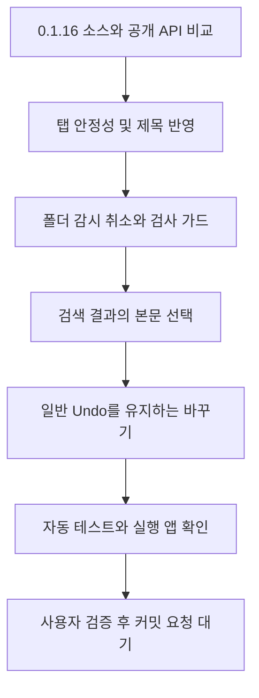

# Herdr 0.1.16 검토 및 Files Workspace 개선

## 1. 목적과 범위

- 검토일: 2026-11-16, Asia/Seoul.
- 비교: Herdr 0.1.15 → 0.1.16.
- 작업 브랜치: `improvements`.
- Herdr 본체를 수정하지 않는다. 공개 모드 API만 사용한다.
- 최소 지원 버전 0.1.13을 유지한다. 신규 API가 없으면 기존 경로를 사용한다.

## 2. 검토 결과

현재 세 모드는 0.1.16의 검사를 통과했다. 실행 중 앱의 오류 목록은 비어 있었다. 이 결과는 전체 UI 기능의 인증을 의미하지 않는다.

| 변경 | 영향과 판단 |
| --- | --- |
| EditorState의 selected_range, set_selected_range, replace, focus | 검색 결과를 본문 선택으로 연결할 수 있다. 교체를 일반 Undo 이력에 남길 수 있다. |
| 기본 탭의 저장값 검증, 휠 누적 처리, 실시간 제목 | 복제한 탭 모드에 별도 반영한다. |
| watchFolder().cancel() | 경로 전환 및 종료 시 이전 대기를 해제한다. |
| checking() | 검사 중 프로세스 실행과 상태 변경을 생략한다. |
| drag_paths() | 파일을 터미널로 끌어 경로를 입력할 수 있다. 기존 이동·복사 드래그와 통합 검토가 필요하다. |
| on_pinch() | 지원 플랫폼에서 이미지·Mermaid 확대에 사용할 수 있다. |
| panes().scroll | Agents View의 맨 아래로 이동 버튼 후보다. 원본 pane과 분할 보기의 연결을 확인해야 한다. |
| tab.new / space.new의 focus:false | 백그라운드 열기 후보다. 기존 동작을 변경할 필요는 없다. |
| setWindowTitle / setBadge | 창 제목 및 macOS Dock 표시 확장이다. 현재 필수는 아니다. |

추가된 terminal.select 계열은 터미널 텍스트용이다. 파일 편집기 API와 혼용하지 않는다. 파일 조회·복사·이동·삭제를 대체할 API 및 편집기 Undo/Redo 직접 호출 API는 추가되지 않았다. 전체 검색 결과를 동시에 강조하는 공개 API도 확인하지 못했다.

본체의 모드 재로드 메모리, 선택 영역 분리, 터미널 설정, macOS 메뉴, pane 확대 포커스 개선은 업데이트 자체에서 적용한다. 사용자 정의 Agents View 확대를 pane.zoom과 같은 것으로 간주하지 않는다.

## 3. 구현 순서와 결과

### 3.1 탭

손상된 panels 저장값은 빈 설정으로 복구한다. 휠은 줄 단위 입력과 부드러운 픽셀 입력을 구분한다. 작은 움직임마다 탭을 전환하지 않는다. 실제 전환이 발생할 때만 Agents View에서 일반 화면으로 돌아간다.

0.1.16의 자동 탭 제목 정책을 반영한다. 사용자가 지정한 이름은 보존한다. 이전 런타임에서 named 필드가 없으면 기존 이름 정책을 사용한다. Agents View의 고정 위치, 아이콘, Space 전환 옵션은 유지한다.

### 3.2 감시 및 검사

폴더 감시 Promise를 보관한다. Space·경로 전환 및 모드 종료 시 cancel을 호출한다. 세대 번호와 현재 경로 검증을 유지하여 취소된 이전 감시가 새 화면을 갱신하지 못하게 한다. 구버전 Promise에 cancel이 없으면 기존 방식으로 종료를 기다린다.

Files 및 Agents View는 checking이 제공되고 true인 경우 초기화 작업을 생략한다. 검사 결과는 실제 런타임 검증을 대체하지 않는다. API가 없는 이전 버전은 기존 초기화를 유지한다.

### 3.3 검색 및 바꾸기

검색 결과 클릭과 Previous/Next는 현재 결과의 UTF-16 범위를 편집기에 설정하고 포커스를 이동한다. 검색어 입력 중에는 포커스를 검색 필드에 유지하면서 선택을 갱신한다. 현재 결과 하나만 선택한다.

새 replace API가 있으면 전체 set_value를 피한다. Replace all은 첫 결과부터 마지막 결과까지의 구간을 한 번에 교체한다. 사이의 비일치 텍스트는 보존한다. 따라서 한 번의 네이티브 편집으로 처리된다. 변경 내용은 기존 초안·수정 표시 경로로 전달하며 파일 저장은 별도다. 이동 중인 파일 및 저장·로딩 중인 문서의 교체는 차단한다.

구버전에서는 결과 목록과 기존 바꾸기·Undo replace를 유지한다. 새 API 경로에서는 내장 Undo 단축키를 사용한다. Undo/Redo 버튼은 추가하지 않는다.

## 4. 검증과 한계

자동 테스트는 손상된 탭 설정, 휠 누적, 제목 정책, 폴더 감시 취소, 이전 Promise 호환, 검색의 UTF-16 범위, 한글·이모지, 교체 잠금 및 한 번의 Replace all 호출을 확인한다. 기존 Agents View, 트리 캐시, 검색 목록, 편집기 헤더, Space 경로 테스트도 실행한다.

실제 키보드 Undo/Redo와 모든 OS의 터치패드 동작은 별도 사용 검증이 필요하다. 0.1.13 런타임 전체 인증을 수행한 것은 아니다. 외부 프로세스를 실행하지 않는 모드 검사와 실제 실행 상태 검사를 구분한다.

Windows의 실제 0.1.16 편집기에 임시 테스트 문서를 표시했다. 운영 코드의 DocumentSearch로 한글·이모지 뒤 선택 범위를 설정하고 selected_range로 확인했다. Replace all의 결과 문자열을 확인했다. 테스트 모드와 임시 패널은 검증 후 제거한다. 사용자 문서에 쓰기나 저장을 하지 않는다.

## 5. 보류한 선택 기능

터미널로 파일 드래그, 핀치 확대, 백그라운드 파일 열기, Agents View의 맨 아래로 이동 버튼은 이번 구현에 포함하지 않는다. 기존 드래그와의 충돌 및 플랫폼 지원을 먼저 확인한다.

## 6. 근거

- [0.1.16 변경 기록](https://github.com/herdrdev/herdr-app/blob/v0.1.16/CHANGELOG.md)
- [Herdr 공개 API](https://github.com/herdrdev/herdr-app/blob/v0.1.16/defaults/herdr.d.ts)
- [편집기 및 UI API](https://github.com/herdrdev/herdr-app/blob/v0.1.16/vendor/gpui-kit/crates/shell/src/typings.rs)
- [편집기 호출 연결](https://github.com/herdrdev/herdr-app/blob/v0.1.16/vendor/gpui-kit/crates/shell/src/input_tokens.rs)
- [기본 탭](https://github.com/herdrdev/herdr-app/blob/v0.1.16/defaults/mods/tabs/main.js)
